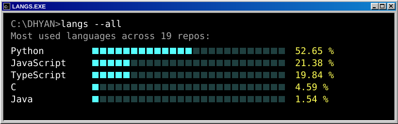
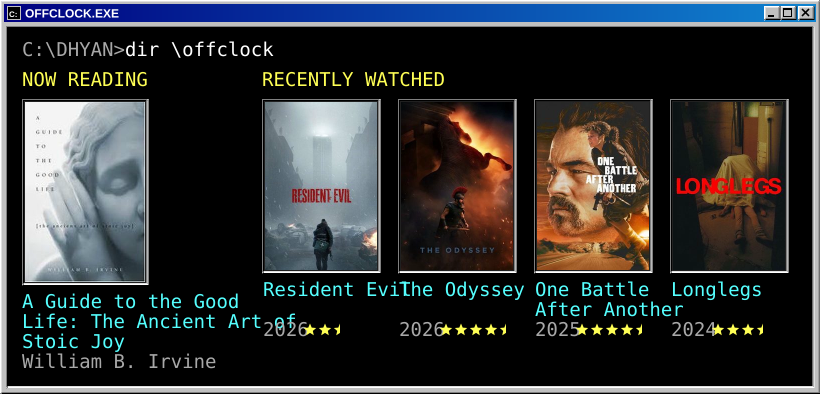

  

##  Hey there!

I'm Dhyan, a senior at the University of Central Florida. 
I build full stack apps, with a focus on the backend. 
Undergrad researcher at UCF, working on gait analysis with wearable sensors. 

## Languages 

## ☕ Off the clock

## Find me

🌐 [dsuresh.dev](https://www.dsuresh.dev) 
💼 [LinkedIn](https://www.linkedin.com/in/dhyansuresh) 
✉️ [dhyan.sur@gmail.com](mailto:dhyan.sur@gmail.com)
