  

  

## 🔨 What I'm working on

* **SignSpeak**: a real time ASL interpreter that runs entirely in the browser. Live hand tracking with MediaPipe is working; next up is a PyTorch classifier trained on hand landmarks from an 87k image dataset.
* **HomePilot**: a local voice and webcam grocery assistant built by a team of four. I own the vision model and the service that recognizes products from photos.

## ⭐ Featured projects

| Project | What it does | Built with |
|:--|:--|:--|
| [SafeFlight](https://github.com/dhyansuresh/SafeFlight) | Track your own flights and your family's, with live map positions, delays, gates and share links that need no account. [Live demo](https://safeflight.onrender.com) | React, TypeScript, Express, PostgreSQL, Prisma |
| [HomePilot](https://github.com/dhyansuresh/home-assistant) | Voice and webcam grocery assistant that runs locally. Built at KnightHacks. | Python, computer vision |
| [SignSpeak](https://github.com/dhyansuresh/asl-interpreter) | Real time ASL recognition in the browser | React, MediaPipe, TensorFlow.js, PyTorch |
| [RealNews](https://github.com/dhyansuresh/realnews) | See how every member of Congress has voted over the last 4 years, explored through a clickable state map. Hackathon project, team of three. | Python |
| [World Cup Watch Party](https://github.com/dhyansuresh/wc-watch-party-bloomhacks2026) | Find and host World Cup watch parties near you. Built at BloomHacks 2026. | React, Firebase |
| [LegalTender](https://github.com/dhyansuresh/morgan-legaltender) | AI legal assistant prototype for the Morgan &amp; Morgan challenge at KnightHacks 2025, my first hackathon | Python, FastAPI, Gemini |

## 🧰 Tools I use

**Languages:** Java · Python · TypeScript · JavaScript · C 
**Web:** React · Node · Express · Vite 
**Data and ML:** PyTorch · TensorFlow.js · MediaPipe · PostgreSQL · Prisma · Firebase

## 📫 Find me

🌐 [dsuresh.dev](https://www.dsuresh.dev)
